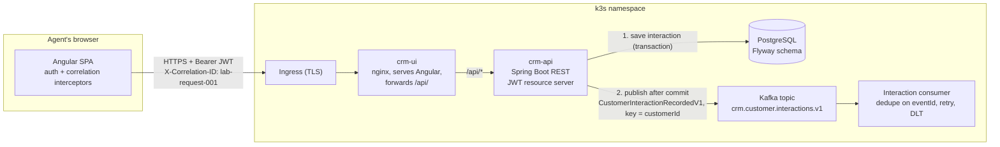

# Containers — Northstar CRM

How the deployable pieces fit together and how data and events move between them.
Demo data is synthetic only: CUS-1001 Amina Khan (ACTIVE), CUS-1002 Ravi Singh (PROSPECT), CUS-9999 (not found).

| Container | Technology | Responsibility |
|---|---|---|
| crm-ui | Angular + nginx | Serves the SPA (search, profile/timeline, interaction form) and forwards `/api/` calls to crm-api |
| crm-api | Spring Boot, Spring Security | Validates JWT and role, validates input, saves the interaction, publishes the event, returns Problem Details errors |
| PostgreSQL | PostgreSQL + Flyway | System of record for customers and interactions |
| Kafka | Apache Kafka | Carries interaction events to consumers |
| Consumer | Spring Kafka | Processes each event once (skips duplicate eventIds), sends failures to a dead-letter topic |

**Images:** `backend/Dockerfile` → crm-api (port 8080) · `frontend/Dockerfile` → crm-ui (nginx, port 8080, forwards `/api/` to crm-api)

**Security path:** Angular interceptor adds `Authorization: Bearer <JWT>` → Ingress (HTTPS) → crm-ui → crm-api checks the token and the AGENT/ADMIN role → 401 if no token, 403 if the role is wrong.

**Request path for CAP-12:** POST `/api/v1/interactions` for CUS-1001 → crm-api saves the row in PostgreSQL → after commit, one event is published to `crm.customer.interactions.v1` → 201 returned to the UI.

Editable draw.io version: [Container-img/container(2).drawio](Container-img/container(2).drawio)