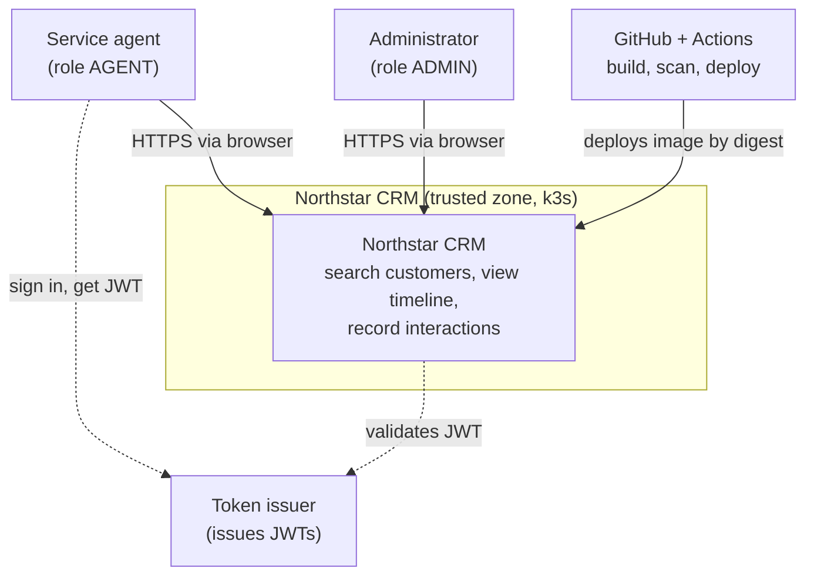

# System context — Northstar CRM

Service agents use Northstar CRM to find customers and record interactions.
Demo data is synthetic only: CUS-1001 Amina Khan (ACTIVE), CUS-1002 Ravi Singh (PROSPECT), CUS-9999 (not found).

**Trust boundaries**
- Browser to the k3s Ingress: untrusted. Every API call needs a valid JWT; the API, not Angular, enforces roles.
- Inside the k3s namespace: API, PostgreSQL and Kafka talk on the cluster network; credentials come from Kubernetes Secrets.
- GitHub to k3s: only the CD workflow deploys, using Environment secrets and an approval gate.
